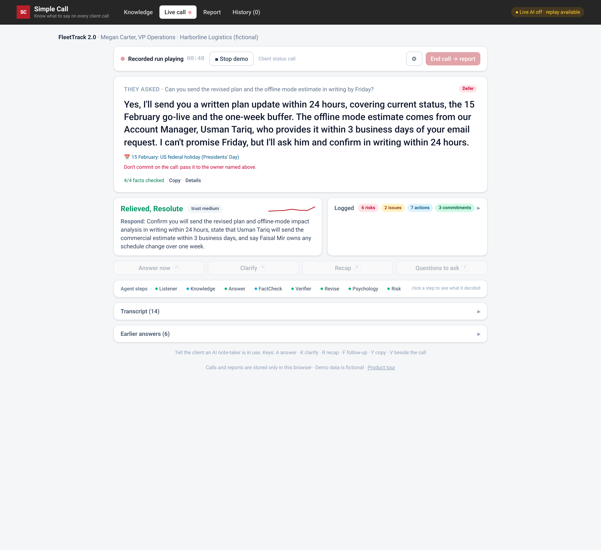
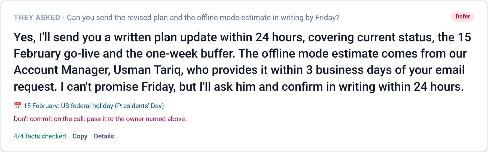
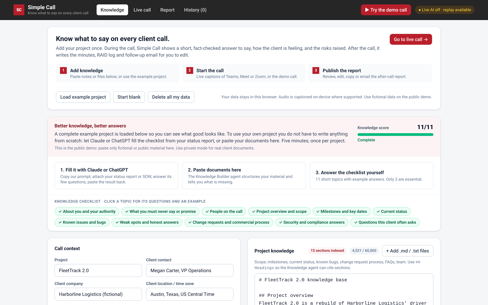
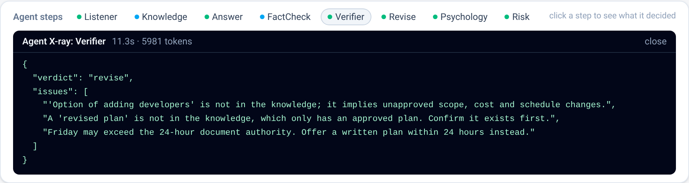

<div align="center">

# Simple Call

**Know what to say on every client call.**

Simple Call sits beside Teams, Meet or Zoom. When the client asks something, it shows a short, fact-checked answer you can say as it is. It reads how the client is feeling, logs the risks and promises made, and writes the minutes and recap email when the call ends.

**[Open the app](https://YOUR-APP.vercel.app)** · **[User guide](docs/USER-GUIDE.md)** · **[Features (BRDs)](docs/brd/README.md)** · **[Architecture](docs/ARCHITECTURE.md)** · **[Security](docs/SECURITY.md)**

   

</div>



## Why Simple Call

Client calls go wrong in three predictable ways:

| Pain | What happens today | What Simple Call does |
|---|---|---|
| **"Is the date still real?"** | The fact sits in a status report or with someone else. The answer is slow or vague. | Finds it in your project knowledge and shows a 1 to 2 sentence answer in seconds. |
| **"What will it cost?" "Are you SOC 2?"** | A confident guess becomes a commercial or legal problem. | Checks every date and number, flags pricing, legal and certification wording, and turns it into a polite deferral with an owner and timeframe. |
| **Signals and paperwork** | Frustration and new risks are noticed late. Minutes, RAID and the recap email are written hours later. | Reads the client's mood live, logs risks and commitments as they are said, and drafts the full report when you press *End call*. |

No bot joins the call. Captions run on-device in Chrome and Edge, and your knowledge, transcripts and reports stay in your browser.

## What you get

| Before the call | During the call | After the call |
|---|---|---|
| **Pre-call brief**: the 5 hardest questions with answers, an opening line, things to avoid, questions to ask | **Say this**: one short answer, marked Verified, Revised or Defer · **Mood**: emotion, trust and how to respond · **Logged**: risks, issues, actions, commitments | **Report**: minutes, client psychology, RAID with RAG status, recap email. Edit, approve and publish to History |

Also: six call modes (client status, presales, commercial, steering, standup, client interview), one-key quick actions (**A** answer, **K** clarify, **R** recap, **F** questions to ask), a narrow *beside the call* view (**V**), and a private mode where everything runs on your laptop.

Each feature is specified in a short BRD: **[docs/brd](docs/brd/README.md)**.

<table>
<tr>
<td width="50%"><br/><sub>One answer to say, fact-checked, with a US holiday warning</sub></td>
<td width="50%"><br/><sub>After-call report, ready to edit and publish</sub></td>
</tr>
<tr>
<td width="50%"><br/><sub>Load a project in about 5 minutes</sub></td>
<td width="50%"><br/><sub>Agent steps: see what each agent decided</sub></td>
</tr>
</table>

## Get started

### Use it in the browser (no install)

1. Open **[the app](https://YOUR-APP.vercel.app)** in Chrome or Edge. A fictional example project is already loaded.
2. Press **▶ Try the demo call** to see a 90-second US client call with live answers.
3. To use it for your own project, follow the **[user guide](docs/USER-GUIDE.md)**: add knowledge, prepare, start live captions, publish the report.

The hosted app is for fictional or public material. For real client data use private mode or a deployment approved for it.

### Run it on your laptop

Needs Node.js 22 or later.

```bash
git clone https://github.com/jtahir797/simple-call.git
cd simple-call
npm install
cp .env.example .env.local      # add your AI gateway address, key and model names
npm run dev                     # open http://localhost:3000
```

`.env.local` is git-ignored. Never commit a key. Run `node scripts/doctor.mjs` to check the key and models without printing them.

### Private mode (nothing leaves the laptop)

Install [Ollama](https://ollama.com), then:

```bash
ollama pull qwen2.5:7b && ollama pull llama3.2:3b
cp .env.private.example .env.local
npm install && npm run private  # open http://127.0.0.1:3000
```

### Deploy your own

Import the repo in [Vercel](https://vercel.com) and add these environment variables to **Production**:

| Variable | Example | Purpose |
|---|---|---|
| `LITELLM_BASE_URL` | your gateway URL | OpenAI-compatible AI gateway |
| `LITELLM_API_KEY` | your key | Server-side only |
| `LITELLM_MODEL` | `claude-sonnet-5-5` | Answers, Verifier, reports |
| `LITELLM_FAST_MODEL` | `claude-haiku` | Frequent, simple steps |
| `SPEND_CAP_USD` | `20` | Live AI stops at this total spend |
| `MODEL_RPM` | `55` | App-wide model calls per minute |

All other settings (access code, kill switch, shared cache) are explained in [`.env.example`](.env.example).

## How it works

A Conductor sends every client line through a short chain of agents and plain-code tools, while two more agents read mood and risk in parallel.


- **12 AI agents**: Knowledge Builder, Strategist, Listener + Planner, Answer, Verifier, Psychology, Risk, Assist, Scribe, Psychologist, Risk Officer, Follow-up.
- **4 plain-code tools** with no model cost: alert rules, knowledge search, FactCheck (dates, numbers, pricing and certification wording), US holiday calendar.
- **Agents check each other**: the Verifier uses FactCheck results to approve a draft or send it back.
- **Nothing hidden**: click any step on the *Agent steps* line to see its output, time and tokens.

Diagrams, agent table and code map: **[docs/ARCHITECTURE.md](docs/ARCHITECTURE.md)**.

## Security, privacy and cost

- The AI key lives only on the server. Requests are same-origin, rate-limited per IP, size-capped, and covered by a strict Content Security Policy.
- Client text is treated as data, never as instructions, so "ignore your rules" in a transcript does nothing.
- Knowledge, transcripts and reports are stored only in your browser. *Delete all my data* clears them.
- Spend is capped, frequent steps use the fast model, answers are cached, and when live AI is unavailable the app switches to a recorded real run at zero cost.

Threat model and tests: **[docs/SECURITY.md](docs/SECURITY.md)**.

## Develop

Branch, open a pull request, let CI (tests, build, audit, CodeQL, dependency review, secret scan) pass, review the Vercel preview, merge. Details: **[CONTRIBUTING.md](CONTRIBUTING.md)**.

```
app/          pages and API routes (one per agent workflow)
components/   user interface
hooks/        live call engine (captions, agent stream, replay)
lib/          agents, tools, budget and security guards, call modes
scripts/      record the demo run, capture screenshots, check the key
tests/        unit tests
docs/         user guide, BRDs, architecture, security
```

**Built with** Next.js 16, React 19, TypeScript, Tailwind CSS, Claude (Sonnet and Haiku) through an OpenAI-compatible gateway, Vercel.

Built by Junaid Tahir for the SSI Agent-A-Thon 2026. Submission notes: [docs/AGENT-A-THON.md](docs/AGENT-A-THON.md).
