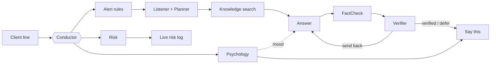
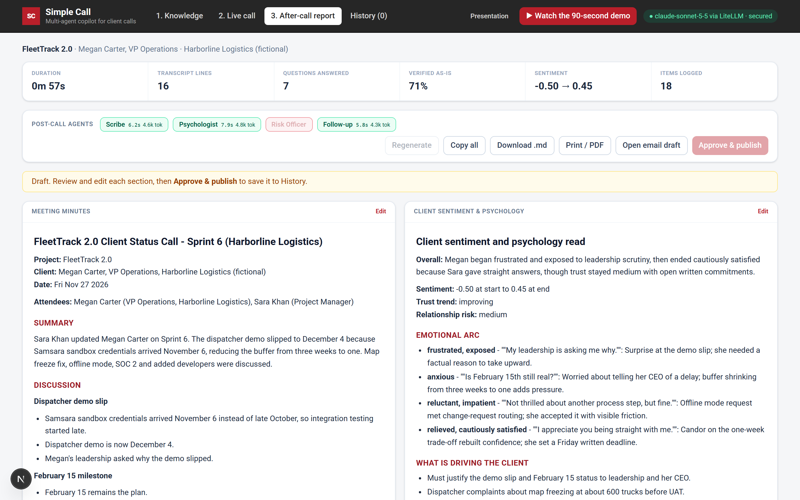
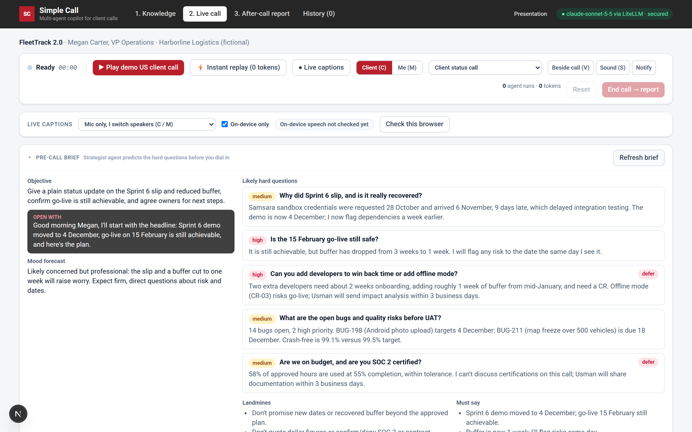

<div align="center">

# Simple Call

**A team of AI agents on every client call.**
Fact-checked answers in seconds, the client's mood read live, and the paperwork done when the call ends.

SSI Agent-A-Thon 2026 · Bring your own idea

**[Live app](https://YOUR-APP.vercel.app)** · **[Presentation (PDF)](docs/Simple-Call-Presentation.pdf)** · **[Architecture](docs/ARCHITECTURE.md)** · **[User guide](docs/USER-GUIDE.md)** · **[Security & cost](docs/SECURITY.md)**

    

</div>


## Judges: try it in 90 seconds

1. Open the **[live app](https://YOUR-APP.vercel.app)**. A complete example project (fictional) is already loaded.
2. Click **▶ Watch the 90-second demo**. A frustrated US client asks about a slipped demo, the go-live date, a price and SOC 2.
3. While it plays, click **Verifier** in the orchestration bar: the first draft quoted a price, so it was sent back and rewritten as a deferral.
4. Click **End call → report**: four agents write the minutes, client psychology, RAID and the recap email.

The slides are also inside the app at **`/present`**.

## The problem

Delivery teams in Pakistan take calls with US clients every week. The hard moment is a question you cannot answer on the spot:

- **"Is the date still real?"** The facts sit in a status report or someone else's head.
- **"What will it cost?" "Are you SOC 2?"** One confident answer becomes a commercial or legal problem.
- **A frustrated client or a new risk** is noticed late, and minutes, RAID and the recap email are written hours later.

## What Simple Call does

| Before the call | During the call | After the call |
|---|---|---|
| Predicts the 5 hardest questions with grounded answers, landmines and an opening line | A fact-checked answer to say, the client's mood with how to respond, and a live risk log. No bot joins the call | Minutes, client psychology, RAID with RAG status and the recap email, ready to edit and publish |

Six call modes: client status · presales · commercial / change request · steering · standup · client interview of our engineers.

## How the agents work together



- **12 AI agents** with distinct roles: Knowledge Builder, Strategist, Listener + Planner, Answer, Verifier, Psychology, Risk, Assist, Scribe, Psychologist, Risk Officer, Follow-up.
- **4 tools in plain code** (no model cost): alert rules, knowledge search, FactCheck (dates, numbers, pricing and certification wording), US holiday calendar.
- **Agents check each other**: the Verifier uses FactCheck results to approve or send a draft back, and the Answer agent rewrites it.
- **Every step is visible**: click any step in the app for its Agent X-ray (output, time, tokens).

Full diagrams, agent table and data flow: **[docs/ARCHITECTURE.md](docs/ARCHITECTURE.md)**.

<table>
<tr>
<td width="50%"><br/><sub>Agent X-ray: the Verifier sends a draft back</sub></td>
<td width="50%"><br/><sub>After-call report written by four agents</sub></td>
</tr>
<tr>
<td width="50%"><br/><sub>Knowledge score and three easy ways to add a project</sub></td>
<td width="50%"><br/><sub>Pre-call brief from the Strategist</sub></td>
</tr>
</table>

## Built for real use

- **Local-first**: on-device speech in Chrome and Edge, both sides of the call captioned from the shared call audio and the mic, all data kept in the browser.
- **Private mode**: the same agents on a local model (`npm run private`), so a real client call never leaves the laptop.
- **Easy setup**: paste a status report and the Knowledge Builder agent does the rest. See the **[user guide](docs/USER-GUIDE.md)**.
- **Safe and cost-efficient**: key only on the server, spend cap under the $25 key budget, 55 calls per minute limit, cache, Haiku for frequent steps, and an automatic switch to a recorded real run if live AI is unavailable. See **[docs/SECURITY.md](docs/SECURITY.md)**.

## Agent-A-Thon rules compliance

| Filter check | How Simple Call meets it |
|---|---|
| Own individual work | One person, own repo, own Vercel account; AI-assisted with Claude (allowed tooling) |
| No client or internal data | All demo data is fictional; no real names, gateway addresses or internal documents in the repo |
| No API key in the code | Key only in Vercel environment variables and a git-ignored `.env.local`; CI fails on any committed key |
| Live on Vercel | Next.js app deployed on Vercel |
| Safe AI-agent settings | Claude Code / Cursor in Accept Edits mode (`.claude/settings.json` sets it and blocks reading `.env` files); agents at runtime only call the model and plain-code tools |
| Agentic, not a single prompt | 12 agents that plan, use tools, hand off and check each other |
| Works end to end | Knowledge → brief → live answers → report → publish → history |
| App stays up, no crashes | Spend cap, calls-per-minute limit, circuit breaker, automatic replay fallback, error boundaries |
| Public repo matches the app | Vercel deploys every push from this repo |

## Run it

```bash
npm install
cp .env.example .env.local      # add the LiteLLM base URL, key and model from the organizers
npm run dev                     # http://localhost:3000
npm run check                   # typecheck + 37 unit tests + dependency audit
```

Deploy: import this repo in Vercel and add `LITELLM_BASE_URL`, `LITELLM_API_KEY`, `LITELLM_MODEL=claude-sonnet-5-5`, `LITELLM_FAST_MODEL=claude-haiku`, `SPEND_CAP_USD=20`, `MODEL_RPM=55` as environment variables.

Recorded demo and screenshots: `npm run record` saves a real run to `public/demo-recording.json` (used by Instant replay), then `npm run capture` refreshes the screenshots and the presentation PDF.

## Repository

```
app/          the app, the /present slides and the API routes (one per agent workflow)
components/   user interface
hooks/        live call engine
lib/          agents, tools, budget and security guards, call modes
scripts/      record the demo run, capture screenshots and the PDF
tests/        37 unit tests
docs/         presentation, architecture, user guide, security, submission summary
public/       screenshots and the recorded demo run
```

**Tech**: Next.js 16, React 19, TypeScript, Tailwind CSS, Claude (Sonnet and Haiku) through the SSI LiteLLM gateway, Vercel.
