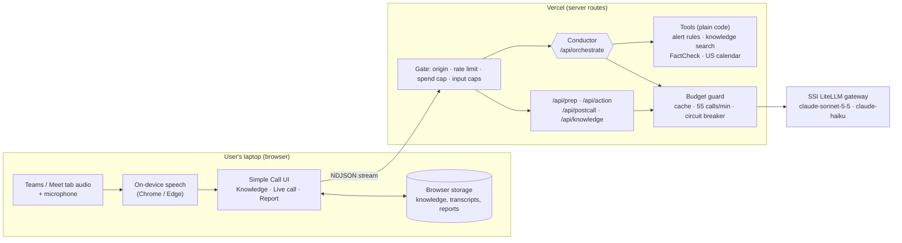
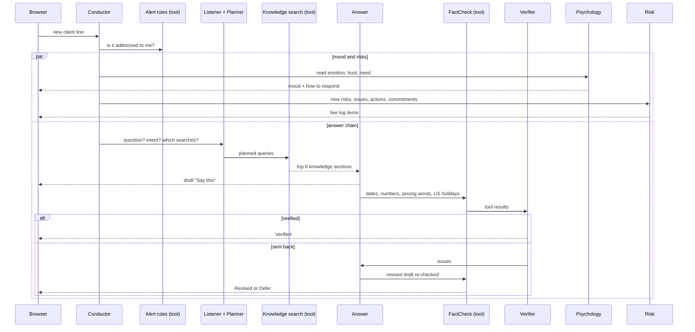
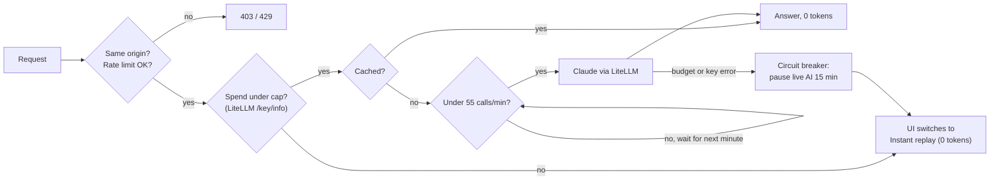

# Simple Call architecture

Simple Call is a Next.js app. The browser handles the screen, on-device speech and storage. Server routes on Vercel run the agents and call Claude through the SSI LiteLLM gateway. The API key never leaves the server.

## 1. System overview



- Every agent step streams back to the screen as it finishes, so the user can watch the orchestration and open any step in the Agent X-ray.
- Nothing about the call is stored on the server. Each request carries only the recent transcript window and the project knowledge it needs.

## 2. One client question, step by step



## 3. Agents

| # | Agent | When | Model | Hands work to |
|---|---|---|---|---|
| 1 | Knowledge Builder | Setup | Sonnet | Turns pasted documents into the knowledge format and asks for gaps |
| 2 | Strategist | Before the call | Sonnet | Pre-call brief: likely hard questions, landmines, opening line |
| 3 | Listener + Planner | Each client line | Haiku | Decides if an answer is needed; plans searches for the Knowledge tool |
| 4 | Answer | Each question | Sonnet | Drafts what to say (1 or 2 sentences, under 40 words); revises when the Verifier sends it back |
| 5 | Verifier | Each question | Sonnet | Approves, sends back, or forces a deferral, using FactCheck results |
| 6 | Psychology | Each client line | Haiku | Emotion, trust, underlying need, how to respond; feeds the Answer agent's tone |
| 7 | Risk | Each client line | Haiku | Risks, issues, actions and commitments, de-duplicated |
| 8 | Assist | On demand | Haiku / Sonnet | Clarify, Recap, Follow-up questions |
| 9 | Scribe | After the call | Sonnet | Minutes, decisions, actions |
| 10 | Psychologist | After the call | Sonnet | Emotional arc, what landed, next-call plan |
| 11 | Risk Officer | After the call | Sonnet | RAID with RAG status (worst-of rule), escalations |
| 12 | Follow-up | After the call | Sonnet | Recap email |

The **Conductor** is plain code: it routes each line, runs chains in parallel or in sequence, and decides when to loop back.

## 4. Tools (no model cost)

| Tool | What it does |
|---|---|
| Alert rules | A client line reaches the Listener only if it names the user, asks a question, makes a request or concern, or mentions a project word |
| Knowledge search | BM25 ranking over the knowledge base, using the Listener's planned queries |
| FactCheck | Every date and number in a draft must exist in the knowledge; scans for pricing, certification, legal and guarantee wording |
| US calendar | Flags promised dates that fall on a US weekend or federal holiday |

## 5. Staying up when live AI is unavailable



## 6. Data and privacy

| Data | Where it lives |
|---|---|
| Audio | Never leaves the laptop with on-device speech |
| Knowledge, transcripts, reports | Browser storage only; deleted with one click |
| API key and gateway address | Vercel environment variables only |
| Model calls | SSI LiteLLM gateway (public demo, fictional data) or a local model in private mode |

## 7. Code map

```
app/
  page.tsx               the app: Knowledge, Live call, Report, History
  present/page.tsx       the presentation (also exported to docs/Simple-Call-Presentation.pdf)
  api/orchestrate        Conductor: live agent chain per transcript line
  api/prep               Strategist
  api/action             Assist quick actions
  api/postcall           Scribe, Psychologist, Risk Officer, Follow-up
  api/knowledge          Knowledge Builder
  api/health             public status (no secrets)
components/              UI: LiveCall, Report, Setup, KnowledgeCoach
hooks/useCopilot.ts      live call engine: captions, queue, replay, quick actions
lib/agents.ts            every agent's prompt and output schema
lib/tools.ts             alert rules, FactCheck, policy scan, US calendar
lib/retrieve.ts          knowledge search
lib/budget.ts            spend cap, calls per minute, circuit breaker
lib/guard.ts             origin check, rate limits, input validation
lib/modes.ts             six call modes
lib/checklist.ts         knowledge checklist and Claude / ChatGPT prompt
scripts/                 record the demo run, capture screenshots and the PDF, check the key
tests/                   39 unit tests
docs/brd/                one business requirements doc per feature
.github/                 CI, CodeQL, Dependabot, PR template, CODEOWNERS
```
